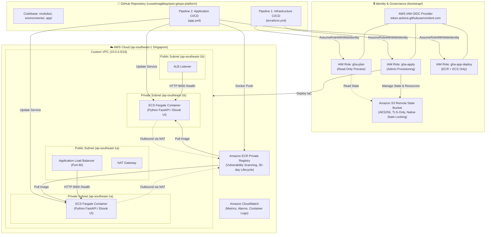

# 🚀 AWS GitOps Platform: Highly Available Containerized Microservice with Passwordless GitHub Actions OIDC CI/CD

[](https://www.terraform.io/)
[](https://aws.amazon.com/)
[](https://github.com/features/actions)
[](https://www.docker.com/)
[](https://fastapi.tiangolo.com/)
[](https://www.checkov.io/)
[](https://trivy.dev/)
[](LICENSE)

An enterprise-grade, GitOps-driven cloud platform provisioned on **Amazon Web Services (AWS)** using **Terraform** and fully automated through **two-speed GitHub Actions CI/CD pipelines** powered by passwordless **AWS IAM OpenID Connect (OIDC)** authentication.

---

## 🏛️ System Architecture



---

## 🌟 Key Engineering Highlights

### 1. Zero-Trust Passwordless CI/CD via AWS IAM OIDC
- **Zero Static AWS Secrets:** Absolutely no long-lived `AWS_ACCESS_KEY_ID` or `AWS_SECRET_ACCESS_KEY` stored in GitHub Secrets.
- **Federated Authentication:** GitHub Actions assumes temporary, short-lived STS credentials via an OIDC Identity Provider (`token.actions.githubusercontent.com`).
- **Strict Least-Privilege Scoping:**
  - `aws-gitops-platform-gha-plan`: Read-only permissions for generating Pull Request previews.
  - `aws-gitops-platform-gha-apply`: Broad infrastructure deployment permissions, strictly gated behind GitHub's **`production` Environment Approval Gate**.
  - `aws-gitops-platform-gha-app-deploy`: Scoped solely to ECR image pushing and ECS task definition updates.

### 2. Two-Speed GitOps Release Pipelines

| Pipeline | Trigger Path | Quality & Security Gates (CI) | Deployment Delivery (CD) |
| :--- | :--- | :--- | :--- |
| **Pipeline 1: Infrastructure** (`terraform.yml`) | `modules/**`, `environments/**` | `terraform fmt`, `terraform validate`, `TFLint`, **Checkov IaC Scanner** | Automated PR plan comment ➔ **Manual Approval Gate** ➔ `terraform apply` |
| **Pipeline 2: Application** (`app.yml`) | `app/**` | Python `pytest` unit testing, Docker non-root build, **Trivy Container Scanner** | Automated push to Amazon ECR ➔ **Zero-Downtime ECS Rolling Update** |

### 3. Highly Available & Fault-Tolerant Multi-AZ Architecture
- **Dual Availability Zones:** Deployed across `ap-southeast-1a` and `ap-southeast-1b` in Singapore.
- **Network Isolation:** Public Load Balancer terminates incoming traffic on Port 80 and proxies requests to ECS tasks running in isolated **Private Subnets** on Port 8000.
- **Zero-Downtime Rolling Updates:** ECS Fargate rolling deployments with `minimum_healthy_percent = 100` and `maximum_percent = 200`.
- **Automated Circuit-Breaker Rollbacks:** Automatic task rollback if health checks fail during deployment, guaranteeing 100% uptime.

### 4. Enterprise FinOps (Cost Optimization)
- Infrastructure can be provisioned in **3 minutes** via GitHub Actions and torn down in **2 minutes** via `terraform destroy`, preventing idle charges from NAT Gateways and Load Balancers while maintaining \$0.00 idle cost.
- Persistent S3 state bucket and IAM OIDC roles remain intact at **\$0.00/month**.

---

## 📂 Repository Directory Structure

```text
.
├── .github/
│   └── workflows/
│       ├── terraform.yml       # Pipeline 1: Infrastructure CI/CD with approval gate
│       └── app.yml             # Pipeline 2: Application CI/CD (Pytest, Trivy, ECR, ECS)
├── app/
│   ├── static/                 # Frontend landing page UI (HTML, CSS, JS, Images)
│   ├── Dockerfile              # Hardened, non-root Python 3.12 container specification
│   ├── main.py                 # FastAPI backend with /health check and static mounting
│   ├── requirements.txt        # Application and test dependencies
│   └── test_main.py            # Automated pytest unit test suite
├── bootstrap/
│   ├── backend.tf              # Remote backend migration for bootstrap state
│   ├── github-oidc.tf          # IAM OIDC Provider & 3 scoped least-privilege roles
│   ├── output.tf               # Exported ARNs and repository variables
│   ├── providers.tf            # AWS Provider configuration
│   ├── state-bucket.tf         # S3 state bucket with encryption, TLS & versioning
│   └── variable.tf             # Input variables for bootstrap phase
├── environments/
│   └── dev/
│       ├── main.tf             # Root module linking all infrastructure modules
│       ├── outputs.tf          # Live ALB DNS, ECR URL, and Cluster outputs
│       ├── providers.tf        # AWS Provider & S3 backend with native state locking
│       └── variables.tf        # Environment-specific configuration variables
└── modules/
    ├── alb/                    # Application Load Balancer & Target Groups
    ├── ecr/                    # Container registry with lifecycle retention policy
    ├── ecs/                    # ECS Cluster, Task Definition & Fargate Service
    ├── monitoring/             # CloudWatch Alarms & SNS Topic alerting
    ├── security/               # Security Groups & ECS IAM execution/task roles
    └── vpc/                    # Multi-AZ VPC, Public/Private Subnets & NAT Gateway
```

---

## 🚀 Deployment Guide

### Prerequisites
- [AWS CLI v2](https://aws.amazon.com/cli/) configured with an administrative profile.
- [Terraform >= 1.11.0](https://www.terraform.io/downloads.html).
- [GitHub CLI (`gh`)](https://cli.github.com/).

### Phase 1: Bootstrap Identity & Remote State
1. Navigate to the bootstrap directory:
   ```bash
   cd bootstrap
   terraform init
   terraform apply
   ```
2. Save the output IAM Role ARNs and S3 Bucket Name as **GitHub Repository Variables** under `Settings > Secrets and variables > Actions > Variables`:
   - `AWS_REGION`
   - `TF_STATE_BUCKET`
   - `AWS_PLAN_ROLE_ARN`
   - `AWS_APPLY_ROLE_ARN`
   - `AWS_APP_DEPLOY_ROLE_ARN`
3. Configure GitHub Environment:
   - Create an environment named **`production`**.
   - Add yourself as a **Required Reviewer** to enforce approval gates.

### Phase 2: Deploy Infrastructure via GitHub Actions
1. Push any Terraform change or manually trigger **Pipeline 1** via the GitHub Actions tab.
2. Review the automated `terraform plan` output generated in the Pull Request or workflow log.
3. Approve the **`production`** deployment gate.
4. Access the live endpoint output by the workflow:
   ```text
   http://<ALB-DNS-NAME>/
   ```

### Phase 3: Deploy Application Updates
1. Modify any frontend or backend code inside `app/`.
2. Commit and push directly to `main`:
   ```bash
   git add app/
   git commit -m "feat: enhance UI and add new feature"
   git push origin main
   ```
3. **Pipeline 2** automatically runs unit tests, scans the image with Trivy, pushes the tagged image to Amazon ECR, and executes a zero-downtime rolling update on ECS Fargate.

---

## 🧹 Teardown (Cost Optimization)

To cleanly destroy all compute and networking resources while maintaining your remote state bucket and OIDC trust:

```bash
cd environments/dev
terraform destroy -auto-approve
```

All AWS billable compute resources (NAT Gateway, Load Balancer, Fargate tasks) will be terminated, returning ongoing costs to **\$0.00**.

---

## 👤 Author

**Russel Magtibay**  
- **GitHub:** [@russelmagtibay](https://github.com/russelmagtibay)
- **Role:** Aspiring Cloud & DevOps Engineer
- **Specialization:** AWS Infrastructure as Code (Terraform), GitOps CI/CD Pipelines, Container Orchestration (Docker/ECS), Cloud Security & FinOps.
